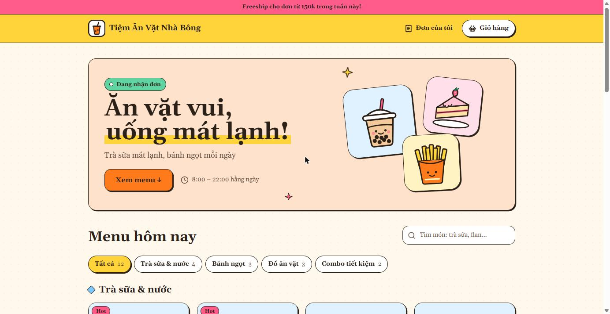
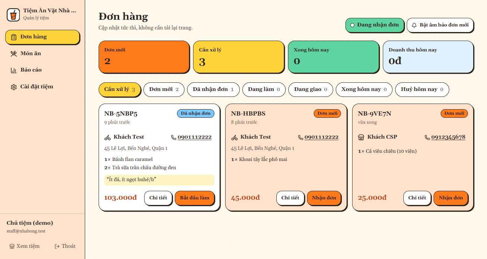
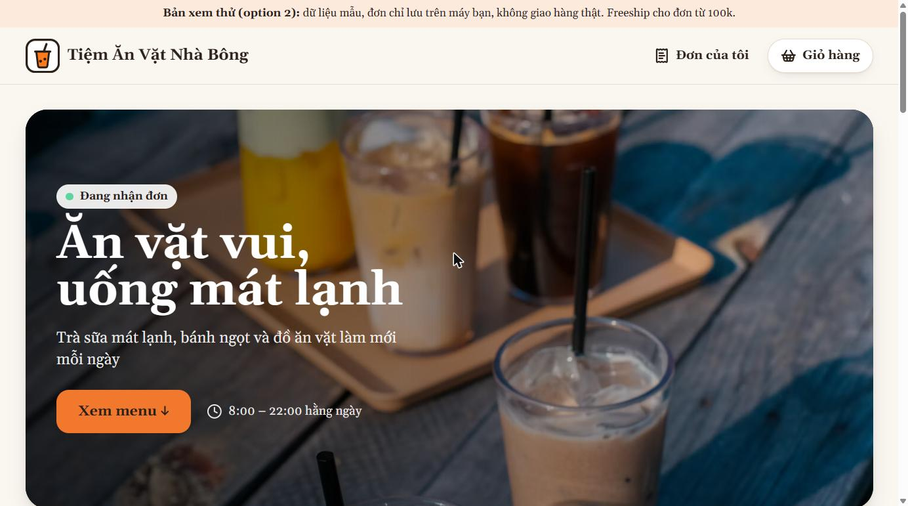

# Con Nhà Bảy Food 🧋

Trang bán đồ ăn vặt (trà sữa, nước, bánh, đồ ăn vặt) cho **một tiệm, nhiều khách**:
khách xem menu và đặt món không cần tạo tài khoản; nhân viên nhận đơn **realtime** trên dashboard, xử lý đơn, quản lý món và cài đặt tiệm.

React 19 · Vite · TypeScript · Tailwind · Zustand · React Hook Form + Zod · **Firebase** (Firestore, Auth, Hosting, App Check)

| Trang bán hàng | Dashboard nhân viên |
|---|---|
|  |  |

> **Nhánh `option-2`** — giao diện "tự nhiên": ảnh chụp thật (Unsplash, nguồn: [docs/CREDITS.md](docs/CREDITS.md)), viền mảnh, bóng mềm.
> Xem thử (chế độ demo, dữ liệu mẫu, không cần Firebase): **https://snack-shop-option-2.vercel.app** ·
> build/deploy lại: `npm run build:demo` rồi `vercel deploy dist --prod`.
>
> 

> Tách ra (clone) từ dự án Antique Shop, chuyển từ Supabase sang Firebase, làm lại giao diện cho đồ ăn vặt.
> So sánh kiến trúc hai dự án: [docs/ARCHITECTURE.md](docs/ARCHITECTURE.md).

## Tính năng

**Khách** (`/`, `/checkout`, `/orders`)
- Menu theo danh mục, tìm món không dấu, xem chi tiết dạng bottom sheet, giỏ hàng nhớ trên máy (đồng bộ giữa các tab)
- **Tuỳ chọn món**: size, % đường, đá, topping (giá cộng thêm hiện ngay)
- Đặt món: giao tận nơi / ghé lấy, **freeship theo ngưỡng** ("mua thêm Xđ để được freeship"), nhớ thông tin cho lần sau, chống bấm trùng
- Thanh toán **tiền mặt** hoặc **chuyển khoản VietQR** (mã QR đúng số tiền + nội dung = mã đơn, quét bằng app ngân hàng bất kỳ)
- Theo dõi đơn tự cập nhật trạng thái, tự huỷ khi tiệm chưa nhận

**Nhân viên** (`/admin`)
- Đơn hàng realtime: âm báo + số đơn mới trên tab, 1 bấm chuyển bước (Nhận → Làm → Giao → Xong), nhắn khách, cảnh báo đơn sai giá,
  badge "CK · chưa nhận tiền" + nút **Đã nhận tiền**
- Soạn tuỳ chọn món (có mẫu đồ uống), cài freeship và tài khoản nhận VietQR
- Đăng nhập quản lý và đặt món thử **trên cùng trình duyệt** không đè phiên nhau
- Quản lý món (bật/tắt "còn bán" 1 chạm, tạo menu mẫu), mở/đóng nhận đơn, phí ship, đơn tối thiểu, thông báo đầu trang
- Báo cáo doanh thu, món bán chạy

## Chạy thử ngay, KHÔNG cần tài khoản Firebase (emulator)

Cần Node 20+ và **Java 11+** (cho Firebase Emulator).

```bash
npm install
npm run dev:local     # MỘT lệnh: bật emulator + tạo dữ liệu mẫu (12 món, tiệm đang nhận đơn) + mở web
```
- Trang khách: http://localhost:5173 · Trang quản lý: http://localhost:5173/admin
  · Xem/sửa DB: http://127.0.0.1:4000/firestore
- **Tài khoản test** (1 quản lý + 3 khách, chỉ có trên emulator) và kịch bản test: [docs/TEST-ACCOUNTS.md](docs/TEST-ACCOUNTS.md)
- DB emulator nằm trong RAM: tắt (Ctrl+C) là xoá sạch, chạy lại lệnh trên thì có lại dữ liệu mẫu.

Chạy từng phần (nếu cần): `npm run dev:emu` (cửa sổ 1) → `npm run seed:emu` → `npm run dev -- --mode emulator`.

## Kết nối Firebase thật

1. [console.firebase.google.com](https://console.firebase.google.com) → **Add project** (gói Spark miễn phí là đủ).
2. **Build → Firestore Database → Create database** (production mode, region gần VN: `asia-southeast1`).
3. **Build → Authentication → Get started** → Sign-in method: bật **Email/Password** và **Anonymous**.
4. **Project settings → Your apps → Web (</>)** → copy config → tạo file `.env` từ `.env.example` và điền 4 giá trị.
5. Cài CLI và deploy rules + index + web:
   ```bash
   npx firebase login
   npx firebase use --add            # chọn project vừa tạo, đặt alias "default"
   npm run deploy                    # = npm run check  +  firebase deploy --only hosting,firestore
   ```
6. Tạo nhân viên đầu tiên và cấu hình tiệm: xem [docs/DATABASE.md](docs/DATABASE.md#thêm-nhân-viên-quản-lý).
   Rồi đăng nhập `/admin` → **Cài đặt tiệm** (bật "Nhận đơn online") → **Món ăn**.
7. Khuyến nghị: bật **App Check** + giới hạn API key: [docs/SECURITY.md](docs/SECURITY.md#việc-chủ-tiệm-cần-làm-trên-console-không-làm-được-từ-code).

## Cơ sở dữ liệu
Sơ đồ, ý nghĩa từng field, cách sửa trong Console: **[docs/DATABASE.md](docs/DATABASE.md)**.

| Collection | Nội dung |
|---|---|
| `products` | Món: tên, giá, danh mục, ảnh, còn bán, nổi bật, thứ tự |
| `settings/shop` | Tên tiệm, hotline, địa chỉ, giờ mở, **mở/đóng nhận đơn**, phí ship, đơn tối thiểu |
| `orders` | Đơn hàng + trạng thái |
| `staff` | Ai là nhân viên (chỉ tạo trong Console) |
| `throttle` | Chống spam đơn (hệ thống tự ghi) |

## Kiểm tra chất lượng

| Lệnh | Làm gì |
|---|---|
| `npm run check` | Quét secret → typecheck → unit test → build → ngân sách dung lượng |
| `npm run test:rules` | 48 ca tấn công vào Firestore rules trên emulator |
| `npm test` | Unit test domain (giỏ, giá, trạng thái, validate, sanitize, khớp rules ↔ code) |
| `npm run check:size` | Dung lượng gzip; JS tải lần đầu ≤ 175KB |

CI (GitHub Actions) chạy tất cả trên mỗi push / pull request.

### Skill cho Claude Code (`.claude/skills/`)
| Skill | Dùng khi |
|---|---|
| `ui-ux-latency-check` | Rà UX luồng đặt món, a11y, Web Vitals, bundle, số lần đọc Firestore |
| `responsive-layout-check` | Kiểm layout 320px → desktop, xoay ngang/dọc, zoom 200%, resize; có script `layout-audit.js` |
| `security-hardening` | DDoS / rate limit / XSS / CORS / CSP / secret / zombie API / rules / App Check |

## Cấu trúc

```
src/
  app/          router (lazy theo route), layout gốc
  config/       danh mục, cấu hình mặc định, menu mẫu
  domain/       logic thuần: giỏ, giá, máy trạng thái đơn, payload đơn (+ test)
  services/     Repository: product / order / settings / auth, orders.live (realtime), mappers
  stores/       Zustand: cart, shop (menu + cấu hình, cache), staff, ui, toast, confirm
  hooks/        useAsync (poll khi tab hiện), useLiveOrders, useAddToCart…
  components/   ui/ (Button, Dialog, FormField…), shop/, admin/, art/ (hình minh hoạ SVG)
  pages/        trang khách + pages/admin
  lib/          firebase (Facade), errors, format, sanitize, id
firestore.rules · firestore.indexes.json · firebase.json (hosting + header bảo mật + emulator)
tests/rules/    test security rules
scripts/        seed emulator, check bundle size, check secrets
docs/           DATABASE · ARCHITECTURE · SECURITY
```

## Thiết kế
Phong cách **"sticker kẹo ngọt"**: nền kem chấm bi, khối màu pastel (chanh, bạc hà, hồng dâu, cam), viền mực 2px, bóng đổ cứng.
Chữ kiểu Georgia (font **Gelasio**: dáng và số đo giống Georgia nhưng đủ dấu tiếng Việt; Georgia gốc trên Windows bị vỡ dấu
ở các chữ ầ, ế, ổ), chữ gốc 18–19px, vùng bấm ≥ 44px, màu chữ đạt tương phản WCAG AA.
Token màu: `tailwind.config.js`. Hình minh hoạ món: `src/components/art/FoodArt.tsx` (SVG, đổi màu theo tên món).
