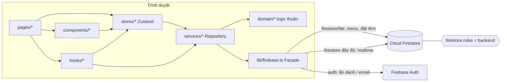

# Kiến trúc & design pattern

## Tổng quan

Luồng phụ thuộc **một chiều**: `pages/components → stores/hooks → services → lib/firebase`. `domain/` không import gì
của React hay Firebase. Chỉ `services/` gọi Firebase SDK; chỉ `services/orders.live.ts` dùng Firestore bản đầy đủ.

## Design pattern đang dùng (và vì sao)

| Pattern | Ở đâu | Vì sao hợp |
|---|---|---|
| **Facade** | `lib/firebase.ts` | Một cửa duy nhất khởi tạo app, emulator, App Check, tải lười Auth/Firestore realtime. Đổi backend chỉ sửa ở đây + services. |
| **Repository** | `services/product.repo.ts`, `order.repo.ts`, `settings.repo.ts` | UI không biết Firestore; mỗi collection một repo, lỗi được dịch sang `AppError` tiếng Việt ở biên. |
| **Adapter / Mapper** | `services/mappers.ts` | Doc Firestore (có thể bị sửa tay sai kiểu) → object domain an toàn. Timestamp → Date. |
| **State Machine** | `domain/orderStatus.ts` + `nextStatuses()` trong rules | Trạng thái đơn chỉ đi đúng hướng; client và server dùng cùng bảng, test so khớp. |
| **Builder (hàm thuần)** | `domain/orderPayload.ts` | Giỏ + form → payload đúng các field rules cho phép; test được không cần Firebase. |
| **Observer** | `orders.live.ts` (`onSnapshot`), Zustand subscribe, `storage` event | Dashboard nhận đơn mới tức thì; giỏ đồng bộ giữa các tab. |
| **Store (Flux nhẹ)** | `stores/*` (Zustand) | State toàn cục nhỏ, selector tránh render thừa; `cart.store` persist localStorage. |
| **Idempotency key** | `cart.store.pendingOrderId` | Id đơn tạo trước → bấm lại / retry mạng không ra đơn trùng (rules chặn ghi đè). |
| **Stale-while-revalidate** | `stores/shop.store.ts` | Hiện menu từ cache ngay, tải bản mới ở nền → nhanh ở lần mở sau, chịu được mất mạng. |
| **Promise-based dialog** | `stores/confirm.store.ts` + `ConfirmHost` | `await confirmDialog()` thay `window.confirm`, đúng giao diện, không chặn luồng. |
| **Code splitting theo route** | `app/router.tsx` + `lazyPage` | Khách không tải code quản lý; tự reload khi chunk cũ bị xoá sau deploy. |

## Đánh giá dự án gốc (Antique Shop) → thay đổi khi chuyển sang Snack Shop

| Antique Shop (Supabase) | Đánh giá | Snack Shop (Firebase) |
|---|---|---|
| Layered + Repository (`services/`) + Mapper lỗi | **Tốt**, giữ nguyên | Giữ, thêm Adapter cho doc Firestore |
| Logic giỏ nằm trong Zustand store (190 dòng) | Khó test, trộn state với nghiệp vụ | Tách thành **hàm thuần** `domain/cart.ts`, store chỉ gọi lại |
| Đồng bộ giỏ server đa thiết bị (`cart_items`, merge/adopt) | Đúng nhưng phức tạp (~300 dòng + 31 test) cho nhu cầu đồ cổ | **Bỏ**: đồ ăn mua ngay, giỏ chỉ cần localStorage + đồng bộ tab |
| RPC `place_order` (transaction, `FOR UPDATE`, tự tính giá ở server) | Rất tốt | Firestore không có stored procedure ở gói miễn phí → batch + **rules** kiểm tra; giá từng món kiểm ở dashboard (xem SECURITY) |
| Tồn kho số lượng + optimistic lock `version` | Cần cho đồ cổ (mỗi món 1 chiếc) | Đồ ăn làm theo đơn → chỉ cờ **còn/hết** |
| Review, like, buyer account, admin users | Hợp với sàn đồ cổ | Bỏ cho gọn: khách đặt **không cần tài khoản** (đăng nhập ẩn danh tự động) |
| `framer-motion` (~45KB gzip) | Nặng so với hiệu ứng dùng | Bỏ: CSS animation + `<dialog>` gốc |
| Dark mode + inline script | Thêm việc cho mỗi màu, cần nới CSP | Bỏ: giao diện sáng tươi, CSP không cần `'unsafe-inline'` cho script |
| Google Fonts | Thêm DNS + request, phụ thuộc bên thứ ba | Font tự host (Gelasio, đủ tiếng Việt) |

## Những gì có thể cải thiện tiếp
- **Cloud Function `onOrderCreate`** (gói Blaze): tính lại giá từ `products`, gắn cờ `verified` → bỏ được cảnh báo giá ở dashboard.
- **Thông báo đẩy** (FCM) cho nhân viên khi tab dashboard không mở.
- **Ảnh món**: Firebase Storage (gói Blaze) + nén ảnh phía client; hiện tại nhập link ảnh https.
- Test E2E (Playwright) cho luồng đặt món ↔ dashboard trên emulator.
