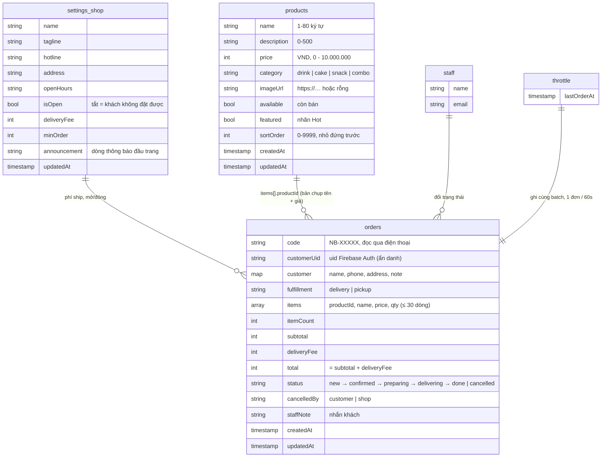
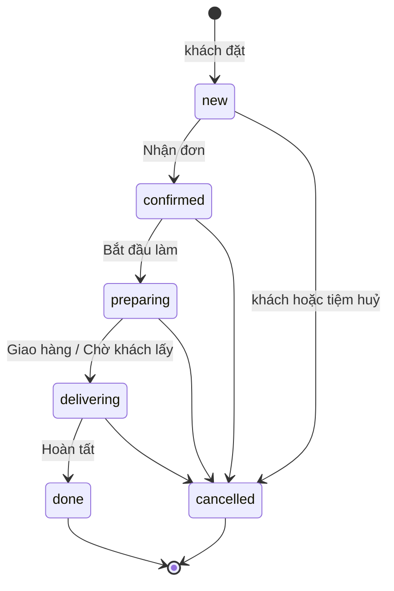

# Cơ sở dữ liệu (Cloud Firestore)

Tài liệu này mô tả **toàn bộ** dữ liệu của tiệm, để chủ tiệm / người kế nhiệm xem và sửa trực tiếp trong
**Firebase Console → Firestore Database**. Nguồn sự thật về quyền: [`firestore.rules`](../firestore.rules).
Khi đổi cấu trúc ở đây, phải đổi **cùng lúc**: `firestore.rules`, `src/types/domain.ts`, `src/services/mappers.ts` và test.

## Sơ đồ

## Các collection

| Collection | Ai đọc | Ai ghi | Ghi chú |
|---|---|---|---|
| `products/{auto-id}` | Mọi người (truy vấn ≤ 200) | Nhân viên | Sửa trong trang **/admin/products** hoặc Console |
| `settings/shop` | Mọi người | Nhân viên | **Một doc duy nhất**, id phải là `shop` |
| `orders/{auto-id}` | Khách: đơn của mình · Nhân viên: tất cả | Khách: tạo + huỷ khi còn `new` · Nhân viên: đổi trạng thái | Không ai xoá được (giữ lịch sử) |
| `staff/{uid}` | Chính người đó | **Chỉ Console** | Có doc = có quyền quản lý |
| `throttle/{uid}` | Không ai | Khách (khi đặt đơn) | Chống spam, đừng sửa tay |

### Trạng thái đơn

## Việc thường gặp trong Firebase Console

### Thêm nhân viên (quản lý)
1. **Authentication → Users → Add user**: nhập email + mật khẩu (người đó tự đổi sau). Copy **User UID**.
2. **Firestore → Start collection** (lần đầu) `staff` → Document ID = **UID vừa copy** → field `name` (string), `email` (string) → Save.
3. Người đó đăng nhập tại `/admin/login`.

### Cho nhân viên nghỉ
Xoá doc `staff/{uid}` **và** Authentication → user đó → **Disable account**.

### Sửa món / giá / mở-đóng tiệm
Nên dùng trang quản lý (`/admin`) vì có kiểm tra dữ liệu. Nếu sửa tay trong Console:
- Giữ đúng **kiểu** (price là *number* nguyên, không phải string; available là *boolean*).
- Không thêm field lạ — rules sẽ từ chối các lần sửa sau từ trang quản lý.
- Doc sửa tay thiếu field vẫn hiển thị được (app tự điền mặc định), nhưng nên sửa lại cho đủ.

### Xem / xuất đơn hàng
Firestore → `orders` → lọc theo `status` hoặc `createdAt`. Xuất hàng loạt: Google Cloud Console → Firestore → Import/Export (cần gói Blaze),
hoặc dùng trang **/admin/report** để xem doanh thu và món bán chạy.

## Index
Định nghĩa trong [`firestore.indexes.json`](../firestore.indexes.json) và deploy bằng `firebase deploy --only firestore:indexes`:
- `orders (customerUid ASC, createdAt DESC)`: trang "Đơn của tôi"
- `orders (status ASC, createdAt DESC)`: dashboard "Cần xử lý"

## Dữ liệu mẫu
- Menu: trang **/admin/products → "Tạo menu mẫu"** (12 món, khi menu trống).
- Emulator (máy dev): `npm run seed:emu` tạo nhân viên demo + `settings/shop`.
