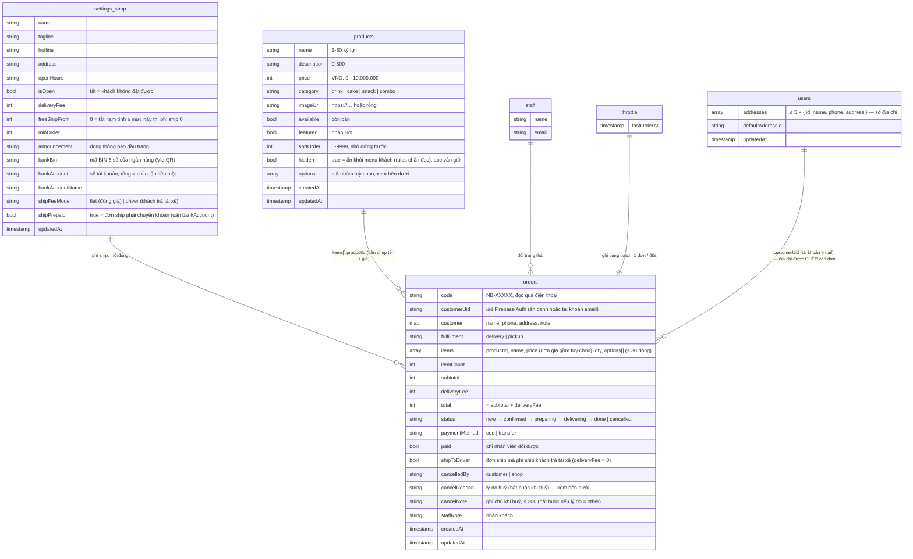
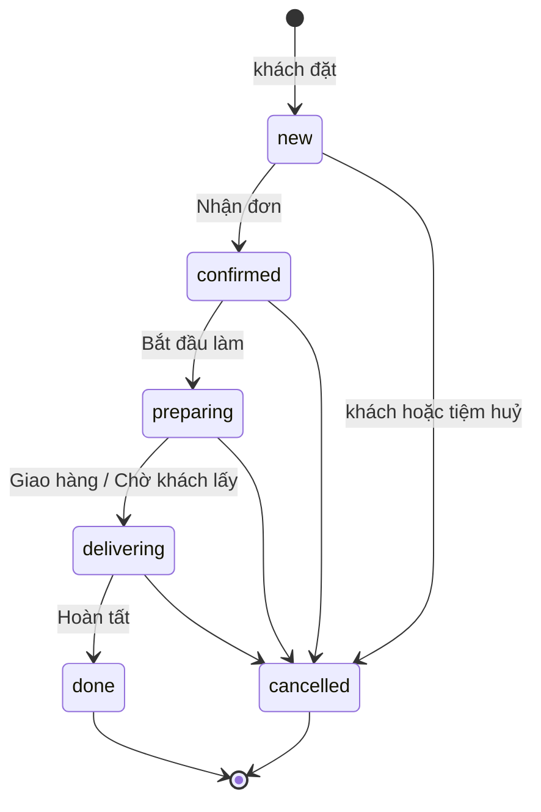

# Cơ sở dữ liệu (Cloud Firestore)

Tài liệu này mô tả **toàn bộ** dữ liệu của tiệm, để chủ tiệm / người kế nhiệm xem và sửa trực tiếp trong
**Firebase Console → Firestore Database**. Nguồn sự thật về quyền: [`firestore.rules`](../firestore.rules).
Khi đổi cấu trúc ở đây, phải đổi **cùng lúc**: `firestore.rules`, `src/types/domain.ts`, `src/services/mappers.ts` và test.

## Sơ đồ



## Các collection

| Collection | Ai đọc | Ai ghi | Ghi chú |
|---|---|---|---|
| `products/{auto-id}` | Khách: món `hidden == false` (truy vấn ≤ 200, phải lọc `hidden`) · Nhân viên: tất cả | Nhân viên | Sửa trong trang **/admin/products** hoặc Console |
| `settings/shop` | Mọi người | Nhân viên | **Một doc duy nhất**, id phải là `shop` |
| `orders/{auto-id}` | Khách: đơn của mình · Nhân viên: tất cả | Khách: tạo + huỷ khi còn `new` · Nhân viên: đổi trạng thái | Không ai xoá được (giữ lịch sử) |
| `staff/{uid}` | Chính người đó | **Chỉ Console** | Có doc = có quyền quản lý |
| `users/{uid}` | **Chỉ chính chủ** (tài khoản email, không phải ẩn danh) | Chính chủ | Sổ địa chỉ. Nhân viên cũng không đọc được (địa chỉ cần thiết đã nằm trong từng đơn) |
| `throttle/{uid}` | Không ai | Khách (khi đặt đơn) | Chống spam, đừng sửa tay |

### Tuỳ chọn món (`products.options`)
Mỗi phần tử là một **nhóm**:
```json
{ "id": "size", "name": "Size", "multi": false, "required": true,
  "choices": [ { "id": "m", "name": "Size M", "price": 0 }, { "id": "l", "name": "Size L", "price": 6000 } ] }
```
- `multi: false` = chọn đúng 1 (size, đường, đá) · `multi: true` = chọn nhiều (topping)
- `price` = tiền cộng thêm (đồng). Đơn giá trong đơn = giá món + tổng `price` các lựa chọn.
- **Đừng đổi `id`** của nhóm/lựa chọn đang bán (đổi tên thoải mái): dashboard dùng id để đối chiếu giá đơn cũ.
- Sửa dễ nhất trong trang **/admin/products → Sửa món → Tuỳ chọn món** (có nút "Mẫu đồ uống").

Trong đơn, `items[].options` lưu bản chụp: `{ group, choice, name, price }`.

### Ẩn / Hiện món (`products.hidden`)
- **Tạm hết** (`available = false`): khách vẫn thấy món, nhưng không đặt được.
- **Ẩn** (`hidden = true`): khách không thấy món nữa (rules chặn cả khi gọi thẳng API). Doc vẫn còn → đơn cũ (đã chụp tên + giá)
  và báo cáo không mất gì, bấm **Hiện** là bán lại.
- **Xoá**: mất hẳn doc, không khôi phục được (đơn cũ vẫn giữ bản chụp tên + giá).
- Mọi món phải có field `hidden` (rules bắt buộc khi ghi). Món tạo trước khi có field này: mở **Sửa → Lưu** một lần,
  hoặc trong Console thêm field `hidden` = `false` (kiểu boolean) — món thiếu field sẽ không hiện cho khách.

### Tài khoản khách & sổ địa chỉ (`users/{uid}`)
- Khách tạo tài khoản bằng **email + mật khẩu** (Firebase Authentication). Không bắt buộc: khách vãng lai vẫn đặt được (phiên ẩn danh).
- Khách đã đặt đơn rồi mới tạo tài khoản → phiên ẩn danh được **nâng cấp** (giữ uid) nên đơn cũ vẫn thuộc tài khoản.
- Quên mật khẩu → Firebase gửi email có link đặt lại; link mở trang `/auth/action` của web (xem docs/SECURITY.md).
- `users/{uid}.addresses`: tối đa 5 người nhận `{ id (≤ 20 ký tự), name (2-60), phone (^(0|+84)[0-9]{9,10}$), address (≤ 200) }`.

### Phí ship (`settings/shop.shipFeeMode`)
- `flat` (mặc định): đồng giá `deliveryFee`, freeship khi tạm tính ≥ `freeShipFrom` → khách biết tổng tiền ngay.
- `driver`: tiệm gọi Grab/Be/Ahamove, **khách trả phí ship cho tài xế**; đơn chỉ tính tiền món (`deliveryFee = 0`, `shipToDriver = true`).
- `shipPrepaid = true`: đơn ship chỉ nhận chuyển khoản (chống bom hàng); ghé lấy vẫn trả tiền mặt được.
- Giờ mở cửa (`openHours`, VD "8:00 – 22:00"): ngoài giờ khách vẫn **đặt trước** được, web báo "tiệm đang đóng cửa, ngày mai tiệm xác nhận".
  Muốn chặn hẳn thì tắt `isOpen`.

### Thanh toán
- Khách chọn **Tiền mặt** hoặc **Chuyển khoản QR** (chỉ hiện khi `settings/shop` có `bankBin` + `bankAccount`).
- Chuyển khoản: trang theo dõi đơn hiện mã **VietQR** (số tiền + nội dung = mã đơn), sinh ngay trên máy khách.
- Nhân viên đối chiếu sao kê rồi bấm **"Đã nhận tiền"** (`paid = true`). Khách không tự đổi được `paid` (rules chặn).

### Huỷ đơn: bắt buộc lý do
Khách (khi đơn còn `new`) hoặc tiệm huỷ đều phải chọn **lý do** (`cancelReason`); **ghi chú** (`cancelNote`) không bắt buộc,
trừ lý do `other` (phải ghi ≥ 3 ký tự). Lý do chỉ ghi được đúng lúc huỷ, không ai sửa lại được. Danh sách (khớp rules +
`src/domain/cancelReasons.ts`):

| Ai huỷ | `cancelReason` |
|---|---|
| Khách | `changed_mind` Đổi ý · `wrong_items` Đặt nhầm món / số lượng · `wrong_info` Sai địa chỉ / SĐT · `too_slow` Chờ lâu quá · `other` Lý do khác |
| Tiệm | `sold_out` Hết món · `shop_busy` Quá tải / sắp đóng cửa · `no_contact` Không liên lạc được khách · `out_of_area` Ngoài khu vực giao · `customer_request` Khách gọi yêu cầu huỷ · `other` Lý do khác |

Đơn huỷ trước khi có tính năng này không có `cancelReason` (trang quản lý ghi "không ghi lý do (đơn cũ)").

### Trạng thái đơn



## Việc thường gặp trong Firebase Console

### Thêm nhân viên (quản lý)
1. Người đó **tạo tài khoản** trên trang bán hàng (Đăng nhập → Tạo tài khoản), hoặc chủ tiệm tạo ở
   **Authentication → Users → Add user**. Copy **User UID** của tài khoản đó (Authentication → Users).
2. **Firestore → Start collection** (lần đầu) `staff` → Document ID = **UID vừa copy** → field `name` (string), `email` (string) → Save.
3. Người đó đăng nhập (ở header trang bán hàng hoặc `/admin/login`) → thấy nút **Quản lý**.

### Cho nhân viên nghỉ
Xoá doc `staff/{uid}` **và** Authentication → user đó → **Disable account**.

### Sửa món / giá / mở-đóng tiệm
Nên dùng trang quản lý (`/admin`) vì có kiểm tra dữ liệu. Nếu sửa tay trong Console:
- Giữ đúng **kiểu** (price là *number* nguyên, không phải string; available là *boolean*).
- Không thêm field lạ — rules sẽ từ chối các lần sửa sau từ trang quản lý.
- Doc sửa tay thiếu field vẫn hiển thị được (app tự điền mặc định), nhưng nên sửa lại cho đủ.

### Xem / xuất đơn hàng
Firestore → `orders` → lọc theo `status` hoặc `createdAt`. Xuất hàng loạt: Google Cloud Console → Firestore → Import/Export (cần gói Blaze),
hoặc dùng trang **/admin/report** để xem doanh thu và món bán chạy.

## Index
Định nghĩa trong [`firestore.indexes.json`](../firestore.indexes.json) và deploy bằng `firebase deploy --only firestore:indexes`:
- `orders (customerUid ASC, createdAt DESC)`: trang "Đơn của tôi"
- `orders (status ASC, createdAt DESC)`: dashboard "Cần xử lý"
- Menu khách lọc `where('hidden', '==', false)`: index 1 field Firestore tự tạo, không cần khai báo.

## Dữ liệu mẫu
- Menu: trang **/admin/products → "Tạo menu mẫu"** (12 món, khi menu trống).
- Emulator (máy dev): `npm run dev:local` (hoặc `npm run seed:emu`) tạo 1 tài khoản quản lý + 3 tài khoản khách (có sổ địa chỉ, đơn mẫu),
  `settings/shop`, menu mẫu + 1 món đang ẩn. Danh sách tài khoản: [TEST-ACCOUNTS.md](TEST-ACCOUNTS.md).
